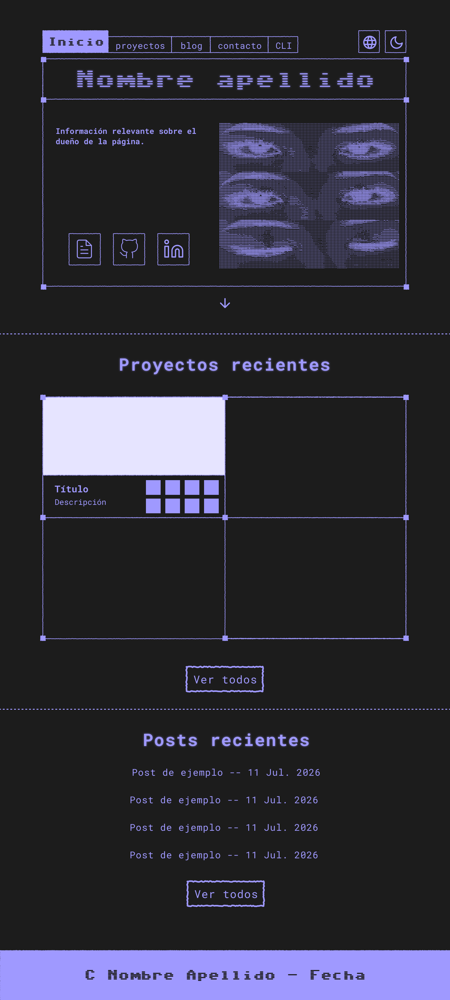
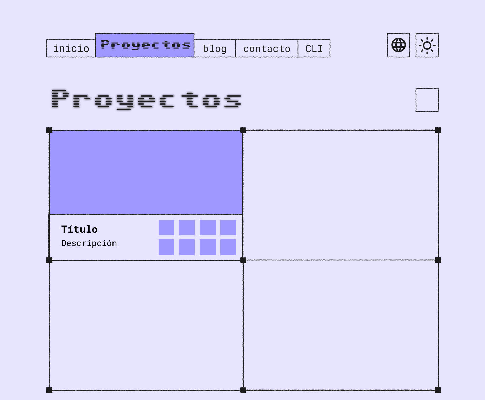
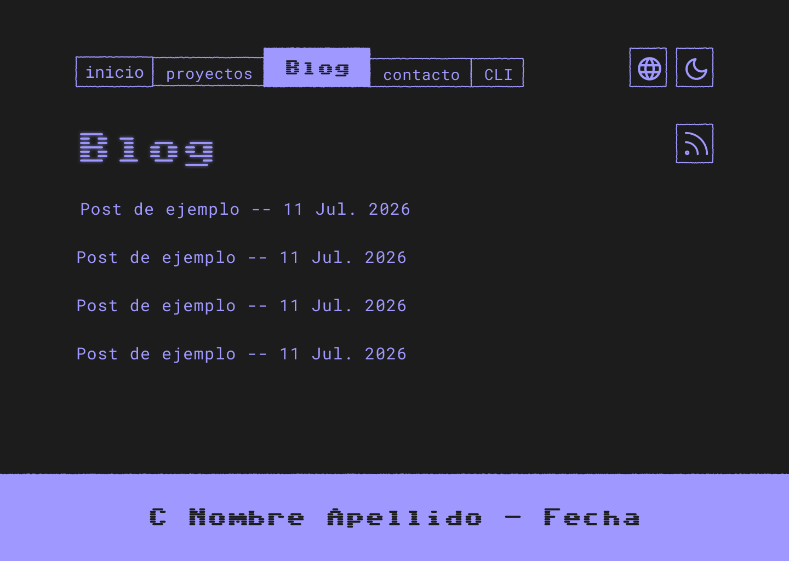

## Why Astro?

I recently graduated in Software Engineering, so I am one step away from entering the workforce. For this reason, I started improving my CV, my GitHub, and began considering the possibility of building my own website. On one hand, it's a great project in itself, and on the other, it gives me the opportunity to have all my information, contact methods, and projects in one place.

When tackling the project, I realized there were four things of special importance for my case:

1. My site must be viewable in multiple languages, as I am a polyglot and do not rule out working abroad.
2. It must have a blog and a collection of projects.
3. It must be structured in such a way that I have to touch as little HTML as possible. I don't want to have to create a new HTML file for every blog post or when I make a new project, as this would delay deployments, nor do I want to have four versions of the same page in different languages, as this would hinder maintainability.
4. I must be able to host it on GitHub Pages, as I don't own a domain or a private server.

For these reasons, I decided I needed to use a "static site generator". These generators usually include features that simplify blog generation from markdown and internationalization tools. There is a large list of options on the market, but I only researched two: Jekyll and Astro.

At first, I decided on [Jekyll](https://jekyllrb.com/) with the [al-folio](https://github.com/alshedivat/al-folio) template that I had seen on researchers' personal pages. I figured that since it was aimed at academics, it would be easy to launch and customize.
My experience was very different. I was able to launch the application without problems, but customizing it to the levels I wanted seemed like a very complex task. The template came with a lot of *bloat*: AI instructions, placeholders, launch methods that didn't fit my use case... Furthermore, I have no experience with Ruby, which made it difficult for me to read the source code. After three days of deleting file after file, reading documentation, and dealing with errors, I got frustrated and quit. Jekyll is everywhere, and that had given me a false sense of ease, but in reality, I was going to spend more time configuring than if I had created a project from scratch.

Therefore, I began the search for another static site generator that would adapt well to my needs: simple documentation, ease of creating projects without a template, and written in a language I am familiar with. This is how I found Astro. I have experience with NPM and Node.js, plus Astro has its own onboarding system and simple, navigable, and unified documentation. For all these reasons, it turned out to be the best choice for my case.

## Designing a Website

Once I had made the decision on which technology would help me handle all the "invisible" parts of my site, I had to choose a design. I considered making a basic and commercial design, but I wanted to express personality and tackle the problem of a "different" design, so I ultimately opted for a "neo-brutalist" or "terminal" style. There would only be two main colors, a retro font, and a CRT screen effect.

With this inspiration in mind, I made my first design prototypes in Figma:

While the design is completely possible without any kind of external library or framework, I wasn't very interested in reinventing the wheel with CSS (not to mention the complexity that would add to my CSS file structures), so I researched my options a bit until I discovered [Tailwind CSS](https://tailwindcss.com/). It provides utility classes to lighten the styling process, and its installation in Astro is direct and simple. I also chose it because I had heard quite a bit about it and thought it was a good opportunity to learn how to use it.

Because of its simple installation in an Astro project, I chose [Lucide icons](https://lucide.dev/).

I also decided I would like my page to have sound effects. This is a feature I have admired on other sites, such as that of the artist and *frontend* developer [shar](https://www.sharyap.com/). I have no experience handling audio in web applications, so I took cues from shar and the community in general ("what libraries are most popular?") and chose the [Howler.js](https://howlerjs.com/) library for sound management. As for the sounds themselves, [Kenney.nl](https://kenney.nl/assets/category:Audio) provides sound effects under a Creative Commons license.

With the base design chosen and the technologies to achieve it ready, I began prototyping, programming, and shaping the page. I quickly put together a set of pages that looked good, and shortly after, I implemented sound muting (with a button in the top corner of the navigation menu) and theme switching (ditto).

Throughout this process, it wasn't just Tailwind CSS that helped me quickly shape the page, but also Astro's component structure, which reminded me of React. I could define a type of button in a component in a short time and turn it into its own "HTML component". This saved me a lot of time and made the development experience much more enjoyable (in addition to contributing to long-term maintainability, of course).

## Internationalization

Astro has its own [internationalization](https://docs.astro.build/en/guides/internationalization/) tools, although I didn't use them extensively. The most important things Astro's tools offer are `Astro.currentLang`, an attribute I used to automatically translate page text, and the `getRelativeLocale(url)` function. In general, I had to create my own internationalization functions.

First, I created a `/i18n` folder and added two files: `utils.ts` and `ui.ts`. The first contains definitions of useful functions for automatic text translation given the target language and the ID of the text to be translated, for automatic route translation (for example: `/es/proyectos` must become `/en/projects`, not `/en/proyectos`), and for fetching content only in the required language. The second contains the list of supported languages, and all application text translated based on an ID.

This system is ideal for the maintainability of a website that will be in multiple languages because it allows a *component-as-page* structure. What do I mean by this? If I have a page where there is no explicit text in Spanish or English, I could create a `/pages/en/index.astro` file containing the text and another `/pages/es/index.astro` where the same text is copied. Although this is not complex, it hinders maintainability because we have code duplicated in two places, and if I want to change it in one, I must remember to copy and paste it into the other version, even if the translation is automatic. This can cause problems in the long run, especially if we add many languages.

Instead, it is better to create a `/pages` subdirectory inside Astro's `/components` folder and place the `indexPage.astro` file there. Now, in `/pages/en/index.astro`, we will only put the component declaration. We do the same with the Spanish page. The result of doing this is that if I want to change something in the page structure, it will be enough to change it in the component, and the change will always look the same in any version without having to copy and paste.

To add new text to a page, it is enough to write it in both Spanish and English (or other languages if any) in the `ui.ts` file with the same ID. Then on the page, we put `useTranslations('textId')` and that's it. Adding a new language would also be simple and would consist of changing the Astro settings to add a new locale, adding all the necessary translations in `ui.ts`, and then in `/pages` creating the folder with the locale prefix and copying and pasting all existing files from another locale's folder (they do not vary between them).

## Dynamic Loading of Posts and Projects with Astro Collections

As I mentioned at the beginning of the post, another thing I wanted to be able to do with my site was write blog posts and have a showcase collection of projects. This feature is implemented in Astro (like in many other static site generators) under the name [Astro Collections](https://docs.astro.build/en/guides/content-collections/). To create a collection, I had to create a `content.config.ts` file to define its schema (what elements make up each member) and the name of the folder where each type of collection can be found. These folders must exist in the `/content` directory of `/src`. Once that was done, I also had to create a basic HTML template to render the blog's markdown files. And with that, I could start writing markdown files (something I am accustomed to in my daily life thanks to my use of Obsidian) to make new posts or publish projects.

## RSS, SEO, and Optimization

Near the end, I was interested in implementing an RSS feed, as this is a feature I use myself to "follow" content from people I'm interested in. Implementing it was also very straightforward thanks to [Astro RSS](https://docs.astro.build/en/recipes/rss/) tools. I only had to set it up as indicated in the documentation, and for each supported language in `/pages/` and collection type, create a corresponding `xml.js` file, which auto-updates when a new item is added to the collection.

I also wanted there to be a certain level of "discoverability" for my site and RSS feeds (this is good because it allows users to put the main link to my page into their trusted RSS reader so all options appear automatically, instead of having to search for it manually on my site, copy it, and paste it).
Therefore, following the instructions in the Astro documentation, [I created a sitemap](https://docs.astro.build/en/guides/integrations-guide/sitemap/), meaning a guide to my site's structure for web crawlers. I included it in the `<head>` of my layout and in the `robots.txt` file. I also added metadata, icons, Open Graph elements, and RSS feeds to the head.

Another element that contributes to a website's SEO is optimization, specifically, that it doesn't take long to load. My site is not very large, but it does feature many images to showcase my projects. For this reason, I did some research and discovered that Astro also has a feature that, if everything is properly configured, automatically transforms `.png` images into `.webp`, a format that takes up less space and loads faster. I implemented it, and now I don't have to worry about `.png` images I add to the project slowing down the page.

## Conclusion

I found Astro to be enormously intuitive and its documentation helpful. I like depending as little as possible on LLMs in my projects, so being able to learn or find quality code examples through other methods is greatly appreciated.

The amount of time dedicated to the site between design, prototyping, development, and testing was roughly a week, which is what I wanted to spend on it, and I am very happy with the result. I attribute the short development time largely to the good initial choice of technologies, as Astro and Tailwind CSS features have been immensely helpful in reducing the work involved.

Therefore, I would use Astro again for any static page that needs it, and I recommend it to anyone who thinks it might be useful in their work.
